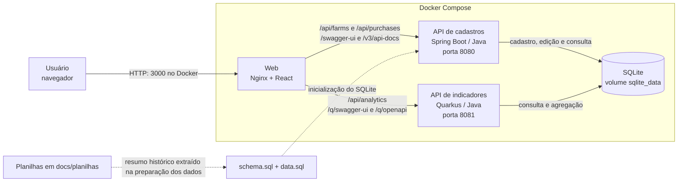
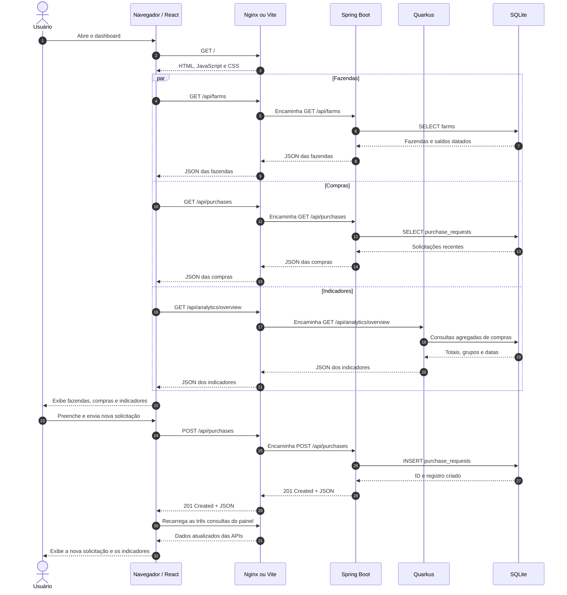

# Diagramas da aplicação Intergado

Os diagramas abaixo representam a implementação atual com Docker Compose e SQLite. Em desenvolvimento local, o Vite serve o React na porta `APP_DEV_PORT` e encaminha as mesmas rotas para as APIs.

Versões para abrir ou compartilhar: [arquitetura em SVG](ARQUITETURA_APP.svg) e [sequência em SVG](SEQUENCIA_APP.svg).

## Arquitetura

As APIs compartilham o mesmo arquivo SQLite. O Spring Boot cria as tabelas e os registros iniciais; o Quarkus lê os dados para calcular indicadores. Os quatro saldos de fazendas cadastrados inicialmente são históricos, de 2021. As planilhas XLSX **não são importadas automaticamente** a cada execução.

## Sequência: abrir o painel e criar uma solicitação

O formulário usa `POST /api/purchases`; a mudança de status usa `PUT /api/purchases/{id}/status`. O Swagger de cadastros permite também `POST` e `PUT /api/farms` e `PUT /api/purchases/{id}`. Consulte os endpoints no [README](../README.md#endpoints).
