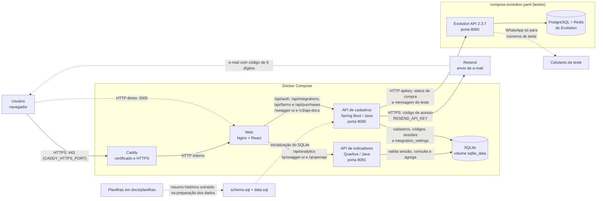
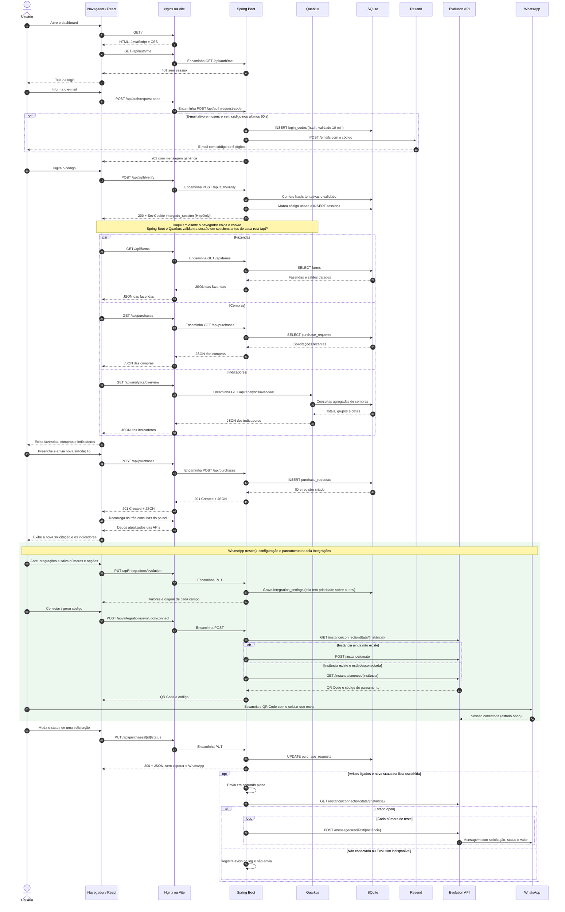

# Diagramas da aplicação Intergado

Os diagramas abaixo representam a implementação atual com Docker Compose, Caddy (HTTPS), SQLite e login por código enviado por e-mail. No diagrama de sequência, “Nginx ou Vite” inclui o Caddy à frente quando o acesso é por HTTPS. Em desenvolvimento local, o Vite serve o React na porta `APP_DEV_PORT` e encaminha as mesmas rotas para as APIs.

Versões para abrir ou compartilhar: [arquitetura em SVG](ARQUITETURA_APP.svg) e [sequência em SVG](SEQUENCIA_APP.svg).

## Arquitetura

As APIs compartilham o mesmo arquivo SQLite. O Spring Boot cria as tabelas e os registros iniciais, gera os códigos de acesso e as sessões; o Quarkus lê os dados para calcular indicadores. As duas APIs validam o cookie `intergado_session` contra a tabela `sessions` em todas as rotas `/api/*`, exceto as de login. O Spring Boot é o único serviço que chama o Resend; sem `RESEND_API_KEY`, o código vai apenas para o log.

O Evolution API roda em um Compose à parte, só para testes. Quando os dois arquivos sobem juntos, o Spring Boot o alcança por `http://evolution-api:8080`; nos scripts de desenvolvimento, por `EVOLUTION_API_URL`. Os dados editáveis das integrações vêm da tela **Integrações** (`integration_settings`) e, na falta deles, do `.env`. Detalhes em [EVOLUTION_API.md](EVOLUTION_API.md). Os quatro saldos de fazendas cadastrados inicialmente são históricos, de 2021. As planilhas XLSX **não são importadas automaticamente** a cada execução.

## Sequência: login, painel, solicitação e WhatsApp

O bloco do WhatsApp só acontece com o `compose.evolution.yaml` ativo. As mensagens vão apenas para os números de teste; a mesma verificação de conexão vale para o botão **Enviar mensagem de teste** (`POST /api/integrations/evolution/test`). Veja [EVOLUTION_API.md](EVOLUTION_API.md).

Sem sessão válida, qualquer rota `/api/*` responde `401` e o React volta para a tela de login; o botão **Sair** chama `POST /api/auth/logout`. O formulário usa `POST /api/purchases`; a mudança de status usa `PUT /api/purchases/{id}/status`. O Swagger de cadastros permite também `POST` e `PUT /api/farms` e `PUT /api/purchases/{id}`. Consulte os endpoints no [README](../README.md#endpoints).
