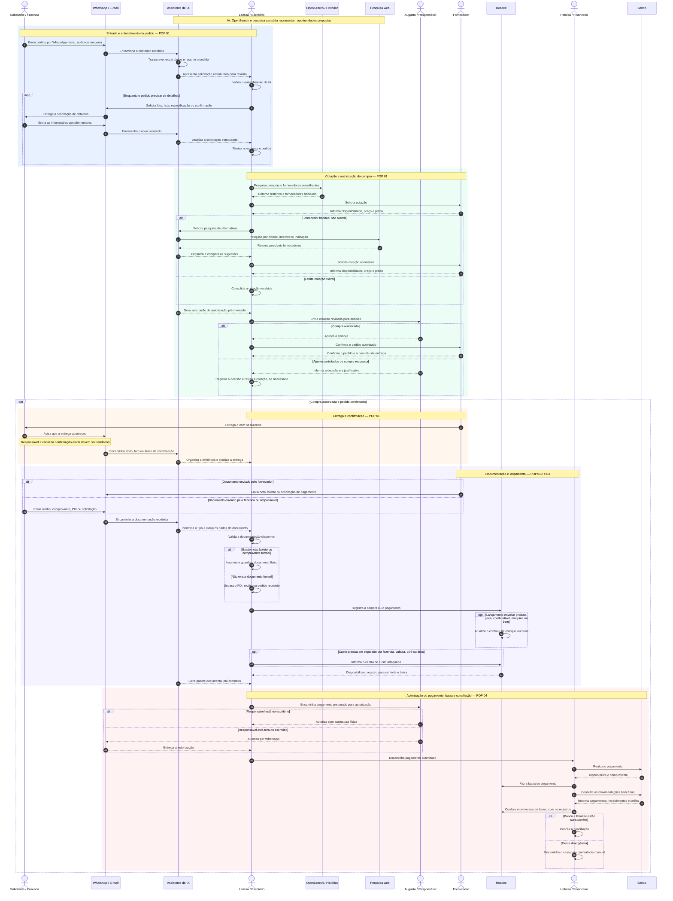

1. Quando alguém da fazenda precisa comprar um produto, peça ou insumo, o pedido
chega ao escritório principalmente por WhatsApp. Esse pedido pode vir de Augusto,
de um gerente, de um agrônomo ou da equipe de campo. (Podemos transcrever texto, audio e imagens)
2. O escritório identifica o que está sendo pedido e tenta entender exatamente qual
produto, peça ou insumo precisa ser comprado. (Resumo com LLM, ou outra IA)
3. Se a informação ainda não estiver clara, Larissa ou o escritório pede mais detalhes
por WhatsApp, como foto, lista, confirmação ou especificação da peça. (Supervisão humana do que foi feito pela IA)
4. Com o pedido entendido, o escritório consulta primeiro os fornecedores habituais. ( Pesquisa automática na base de dados OpenSearchIA de pedidos anteriores semelhantes )
5. Se os fornecedores habituais não resolvem, o escritório procura alternativas fora da lista conhecida, usando cidade, internet ou indicação. ( Pesquisa web com IA apresentando melhores sugestões)
6. Quando há uma cotação viável, o escritório reúne a informação e pede autorização a Augusto ou ao responsável aplicável. (Podemos deixar algo já pré montado)
7. Depois da autorização, o escritório faz o pedido ao fornecedor. ( Apresentamos o que foi autorizado com todo o fluxo já percorrido)
8. O fornecedor entrega o item na fazenda. ( Pode ser recebido uma mensagem, foto ou audio da confirmação )
9. Quando a entrega acontece, o escritório é avisado. ( Pode ser recebido uma mensagem, foto ou audio da confirmação )
10. Com a entrega confirmada, o processo segue para pagamento e documentação. ( Geramos todo o pacote de documentação para pagamento)

## Fluxo de atendimento e oportunidades de melhoria

```mermaid
flowchart TD
    INICIO([Necessidade de compra na fazenda]) --> E1["1. Receber o pedido pelo WhatsApp"]
    E1 --> O1["Oportunidade: transcrever textos,<br/>áudios e imagens"]
    O1 --> E2["2. Identificar e interpretar o item solicitado"]
    E2 --> O2["Oportunidade: resumir a solicitação<br/>com LLM ou outra IA"]
    O2 --> E3["3. Solicitar detalhes adicionais pelo WhatsApp"]
    E3 --> O3["Oportunidade: supervisão humana<br/>do trabalho realizado pela IA"]
    O3 --> E4["4. Consultar fornecedores habituais"]
    E4 --> O4["Oportunidade: pesquisar automaticamente<br/>pedidos semelhantes no OpenSearch"]
    O4 --> E5["5. Pesquisar fornecedores alternativos"]
    E5 --> O5["Oportunidade: pesquisa web com IA<br/>e apresentação das melhores sugestões"]
    O5 --> E6["6. Reunir a cotação e solicitar autorização"]
    E6 --> O6["Oportunidade: deixar a solicitação<br/>de autorização pré-montada"]
    O6 --> E7["7. Fazer o pedido ao fornecedor"]
    E7 --> O7["Oportunidade: apresentar o que foi autorizado<br/>com todo o fluxo percorrido"]
    O7 --> E8["8. Receber o item na fazenda"]
    E8 --> O8["Oportunidade: receber a confirmação<br/>por mensagem, foto ou áudio"]
    O8 --> E9["9. Avisar o escritório sobre a entrega"]
    E9 --> O9["Oportunidade: receber a confirmação<br/>por mensagem, foto ou áudio"]
    O9 --> E10["10. Encaminhar pagamento e documentação"]
    E10 --> O10["Oportunidade: gerar todo o pacote<br/>de documentação para pagamento"]
    O10 --> FIM([Processo concluído])

    classDef etapa fill:#e8f1ff,stroke:#2563eb,color:#172554;
    classDef oportunidade fill:#ecfdf5,stroke:#059669,color:#064e3b;
    class E1,E2,E3,E4,E5,E6,E7,E8,E9,E10 etapa;
    class O1,O2,O3,O4,O5,O6,O7,O8,O9,O10 oportunidade;
```

## Diagrama de sequência proposto

O diagrama abaixo foi elaborado com apoio dos POPs 01 a 04 do documento
[Diagnóstico preliminar dos processos](./03_Diagnostico_Preliminar_Processos_POPs.pdf).
Ele mostra a interação entre as
pessoas, os sistemas e os fornecedores desde a solicitação da compra até o pagamento
e a conciliação. A automação apoia a operação, mas o escritório continua responsável
por validar o entendimento do pedido e conduzir as decisões.

> Pontos do diagnóstico que ainda exigem validação: quem pode autorizar além de
> Augusto; se existe uma lista formal de fornecedores habituais; quem avisa o
> escritório sobre a entrega e por qual canal; e se Heloísa é a responsável financeira
> definitiva por toda a rotina.
